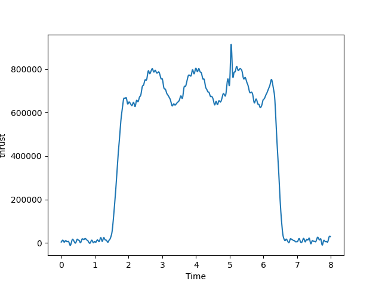
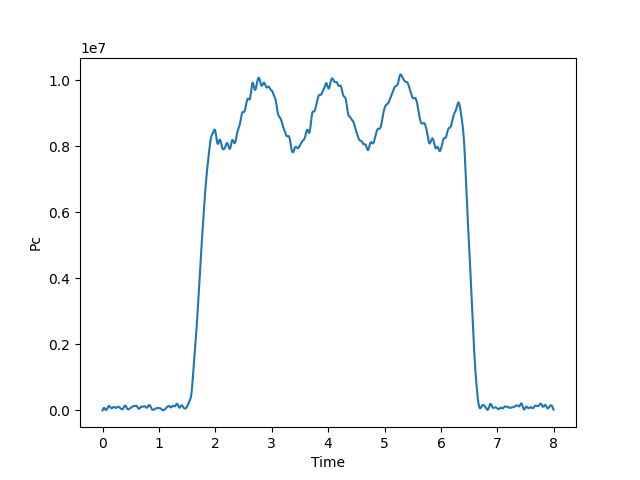

# Engine Test Analysis Pipeline

Full analysis for rocket engine test data.
- Imports telemetry from a test firing
- Synchronizes multiple sensors
- Filters noise
- Calculates derived parameters
- Flags anomalies

## Example parameters:
- chamber pressure
- thrust
- propellant mass flow rate
- mixture ratio
- injector pressure drop
- engine temperature

## Example outputs:
### Plots
##### Thrust vs Time

#### Chamber Pressure vs Time

#### Mixture Ratio vs Time

#### Isp (Calculated)

- anomaly detection system

